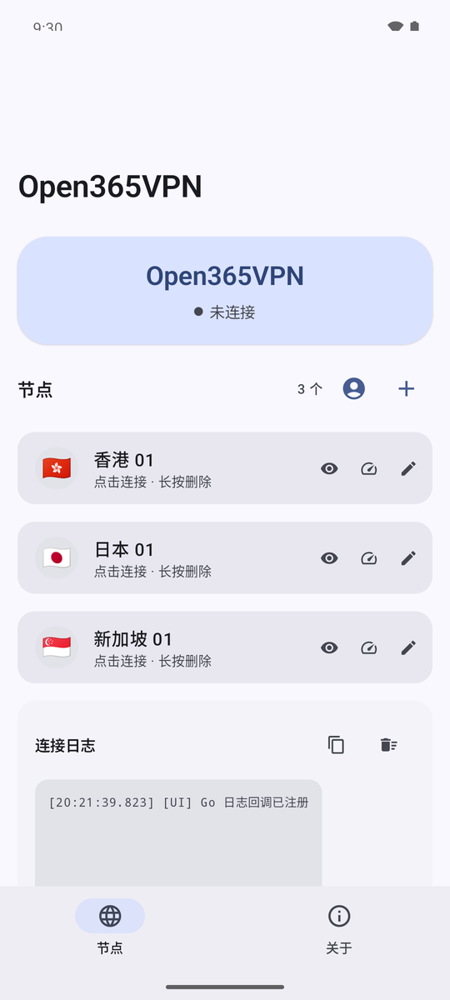
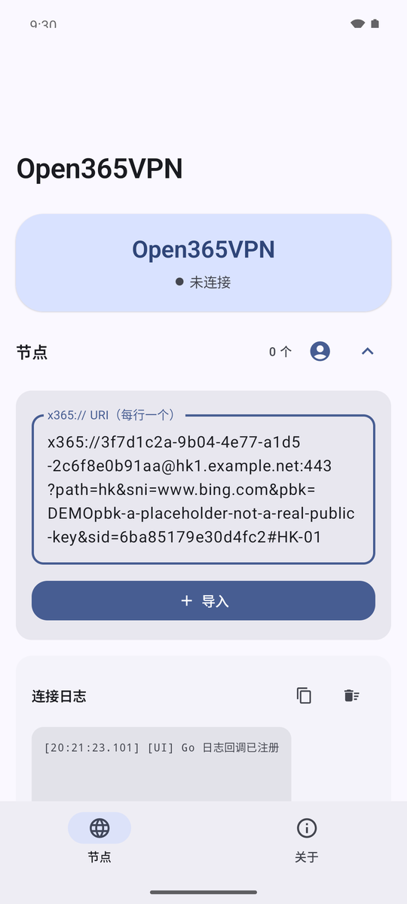
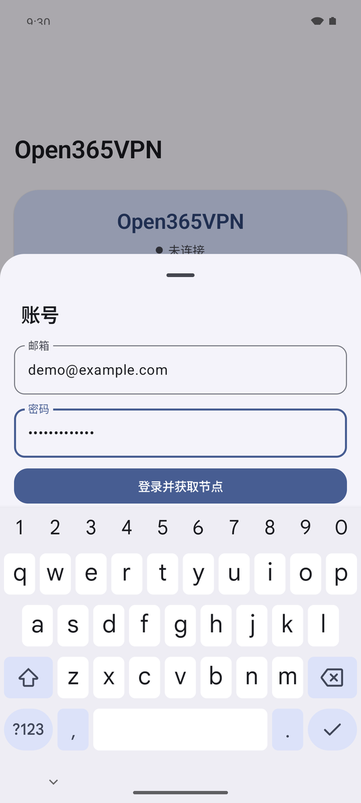
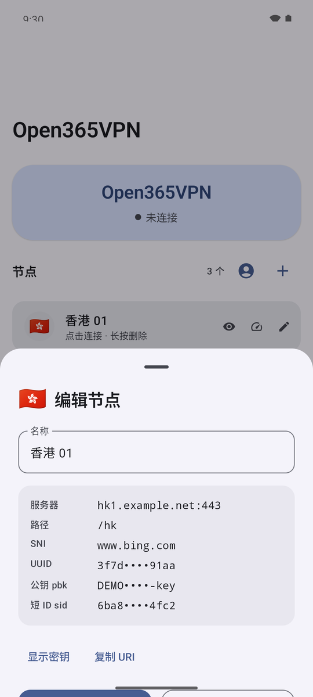
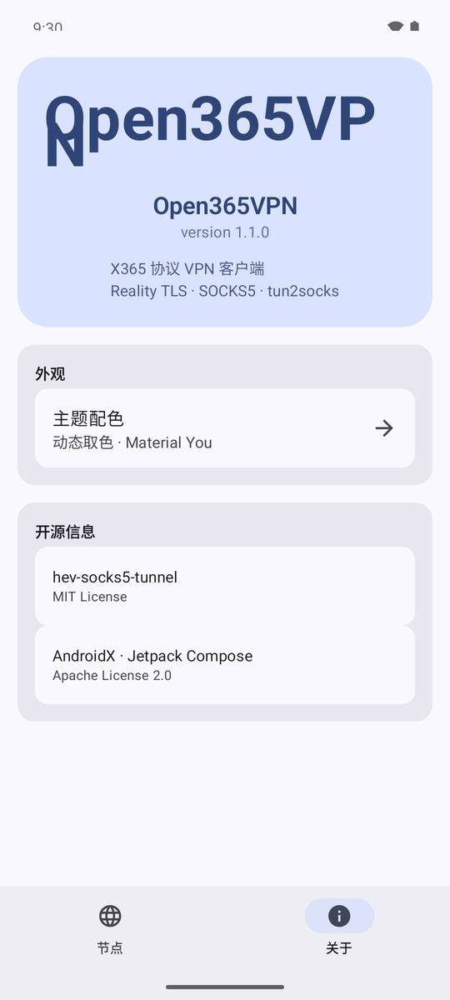
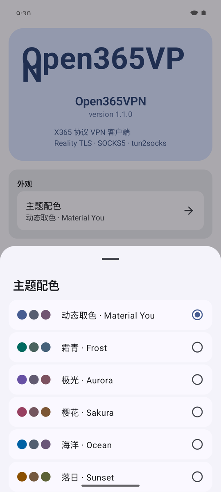

<div align="center">
  
</div>

# Open365VPN

Open365VPN 是一个基于 X365 协议的 Android VPN 客户端。X365 协议在设计上
受到其他 VPN / 代理隧道协议的启发，但协议格式与本项目全部实现均为独立
设计、独立开发，不基于任何第三方客户端的源码；与任何第三方 VPN 服务商
（包括名称相近的服务商）没有任何隶属、授权或合作关系。
本项目不捆绑任何服务器节点或账号凭证。

## 功能

- X365 协议（REALITY TLS + gRPC 风格 chunked 传输）
- VpnService 全局接管流量（tun2socks）
- 账号登录：邮箱/密码 → 自动拉取节点列表（协议见下文）
- 节点管理：`x365://` URI 导入 / 删除 / 测速
- 出口 IP 与地理位置检测
- Material You 动态取色主题

## 界面

| 节点与连接状态 | 导入 x365:// URI | 账号登录 |
| :---: | :---: | :---: |
|  |  |  |
| 状态仪表盘、节点列表与连接日志 | 粘贴 `x365://` URI 批量导入 | 邮箱/密码登录并拉取节点 |

| 节点详情 | 关于 | 主题配色 |
| :---: | :---: | :---: |
|  |  |  |
| 协议参数（密钥默认打码） | 版本与开源信息 | 动态取色 / 5 套固定配色 |

> 截图取自 Android 16（API 36）模拟器（Pixel 7，1080×2400）。节点与账号均为演示数据
> （`*.example.net`、`demo@example.com`），仓库不附带任何真实节点或凭据。

## 使用

### 账号登录（推荐）

「节点」页右上角点击头像图标，输入账号邮箱和密码，
登录成功后自动拉取全部节点。凭据仅保存在本机
（SharedPreferences），应用启动时自动刷新节点。

### 手动导入

也可以直接粘贴 `x365://` URI 导入节点，无需账号。

## 协议说明

本应用接入账号服务 API 的方式：

1. **x-sig 头**：设备信息 JSON 按 245 字节分块，逐块用服务端 RSA-2048
   公钥做 PKCS#1 v1.5 加密，拼接后 base64。载荷无时间戳/nonce，
   同设备可复用。
2. **登录**：`POST /v1/auth/login` `{email,password,reg:false}` +
   `x-did`/`x-sig` → `{access_token}`（JWT）。
3. **取节点**：`GET /v1/app?flag=wassvpn` + `authorization: <JWT>` →
   JSON 的 `proxy` 字段为 base64(RSA-2048 块)，私钥逐块解密、拼接、
   zlib 解压后得到节点 YAML（含 `x365://` 链接）。

实现见 `app/src/main/java/com/open365/vpn/protocol/X365Api.kt`。独立的
Go 实现见 [x365-cli](../x365-cli/x365-cli/README.md)。

## 构建

### 依赖

- Android SDK (compileSdk 36) 与 NDK 27
- Go 1.26+ 与 gomobile（用于重新生成 `app/libs/x365.aar`）
- JDK 17

### Native 组件

`app/src/main/jniLibs/` 下的 `libhev-socks5-tunnel.so` 由本仓库
`hev-socks5-tunnel/` 目录的源码构建。本仓库布局没有 `jni/` 子目录，
需要显式指定 `Android.mk`；`APP_PLATFORM=android-21` 与 `minSdk` 一致：

```sh
cd hev-socks5-tunnel
$ANDROID_NDK_HOME/ndk-build NDK_PROJECT_PATH=. APP_BUILD_SCRIPT=./Android.mk \
  APP_PLATFORM=android-21 APP_ABI="arm64-v8a armeabi-v7a x86_64" \
  APP_CFLAGS="-DPKGNAME=com/open365/vpn -DCLSNAME=X365VpnService"
# 产物在 libs/<abi>/libhev-socks5-tunnel.so，复制到 app/src/main/jniLibs/<abi>/
```

`x86_64` 供 x86_64 模拟器使用。JNI 绑定的 Java 类为
`com.open365.vpn.X365VpnService`。

### Go 组件

`app/libs/x365.aar` 由 X365 协议的 gomobile 绑定生成。需要在
`x365-mobile/` 模块内执行（其 `go.mod` 通过 `replace` 指向 `../x365-core`），
且 `PATH` 中有与 `go.mod` 一致的 `gobind`：

```sh
cd ../x365-mobile
go install golang.org/x/mobile/cmd/gobind@v0.0.0-20260821190718-4776eadac327
gomobile bind -trimpath -target android -androidapi 21 \
  -o ../x365-android/app/libs/x365.aar github.com/SakurakaiCat/x365-mobile
```

### 打包

```sh
./gradlew assembleDebug
```

### 模拟器

`jniLibs/x86_64` 已包含 x86_64 的 native 库，可直接在 x86_64 模拟器
（`google_apis` 镜像）上运行：

```sh
avdmanager create avd -n x365_api36 -k "system-images;android-36;google_apis;x86_64" -d pixel_7
$ANDROID_HOME/emulator/emulator -avd x365_api36 -no-window -gpu swiftshader_indirect &
adb install -r app/build/outputs/apk/debug/app-debug.apk
adb shell am start -n com.open365.vpn/.MainActivity
```

## 依赖与许可

- X365 协议核心：[x365-core](../x365-core/README.md)（MIT）
- hev-socks5-tunnel（MIT）
- AndroidX / Jetpack Compose（Apache 2.0）

本项目以 MIT License 发布，详见 [LICENSE](../LICENSE)。

## 免责声明

本项目仅供学习与研究网络协议使用。使用者应遵守所在地区的法律法规，
本项目作者不对任何使用行为承担责任。
